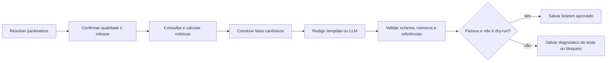

# 06 — Automação de boletins verificáveis

**Estado demonstrado:** MVP validado. Evidências de 28/10/2026 quando aplicável.

Este documento preserva requisitos e design do estudo. Etapas futuras, quantidades planejadas e critérios de aceite não comprovam execução. Consulte o estudo de caso para escopo, resultados e limites atuais.

**Estado do plano original:** somente planejado; nenhuma agenda será ativada nesta etapa. **Competência:** operar um fluxo recorrente de dados/IA com idempotência e rastreabilidade. **Dependências:** 01 e 02; redação avaliada pelo protocolo do 04. O 05 é integração opcional, não um bloqueio para o primeiro boletim.

## Objetivo e requisitos

Transformar métricas aprovadas em um boletim semanal salvo no Databricks, com conferência numérica e histórico de execução.

| ID | Requisito | Aceite futuro |
| --- | --- | --- |
| RF01 | Calcular período e métricas por código | Período, timezone e comparação inequívocos |
| RF02 | Consumir somente release Gold aprovada | ID da release e checks anexados |
| RF03 | Gerar rascunho por template ou LLM | Mesmo contrato de saída nas duas variantes |
| RF04 | Validar números e referências | Nenhuma métrica inventada na publicação |
| RF05 | Evitar duplicação por repetição/retry | Uma saída lógica por chave do boletim |
| RF06 | Recuperar falhas intermediárias | Retomar sem recalcular/publicar incorretamente |
| RF07 | Separar dry-run de publicação interna | Dry-run grava apenas evidência de teste identificada |
| RNF01 | Manter operação barata e compreensível | Execução manual antes de agenda; sem canal externo |

Fora do MVP: e-mails, Slack, WhatsApp, postagem pública e acionamento autônomo de pessoas. A entrega é uma tabela/arquivo no próprio Databricks.

## Entradas, saídas e contratos

Parâmetros: `library_id`, `period_start`, `period_end_exclusive`, `comparison_start`, `comparison_end_exclusive`, `data_reference`, `config_version`, `dry_run`.

Período inicial proposto: semana anterior fechada, segunda a domingo na timezone `America/Sao_Paulo`, usando limites inclusivo/exclusivo convertidos para UTC. A comparação deve ter a mesma definição de duração/calendário. Feriados e número de dias podem afetar a interpretação, sem inferir causalidade.

Tabelas propostas em `workspace.estudos_ai`: `aurora_boletim_execucoes`, `aurora_boletins`, `aurora_boletim_metricas`. Chave lógica: biblioteca + período + versão de configuração. Guardar tentativas com execution_id separado, sem duplicar o boletim.

Resposta estruturada: `status`, `text`, `metric_references`, `warnings`, `period`, `gold_release_id`, `prompt_version`. Métricas recebem IDs; o texto usa esses IDs para rastrear cada observação.

## Arquitetura e operação

Implementar estados requested → validated_data → drafted → checked → published ou blocked/failed. Publicação interna usa upsert idempotente e guarda hash do conteúdo. Se a chave já existir com entradas e configuração iguais, retornar a saída existente; se a Gold mudar, gerar revisão explícita, preservando o original.

Retries apenas para falhas transitórias e em tarefas idempotentes: até 2 novas tentativas. Falha de conferência é bloqueio, não motivo para repetir o LLM indefinidamente. Uma chamada externa de LLM pode ser repetida após falha de rede sem garantia de não ter consumido tokens: registrar tentativas e tratar consumo desconhecido como desconhecido.

## Tecnologias e bibliotecas

| Componente/lib | Uso |
| --- | --- |
| Lakeflow Jobs | DAG, parâmetros, dependências e futura agenda |
| SQL/PySpark e Delta | Métricas, tabelas de estado e upsert |
| Python `datetime`, `zoneinfo`, `decimal` | Datas, timezone e arredondamento de valores |
| `pydantic` | Fatos canônicos e saída do redator |
| `jinja2` | Baseline determinístico de texto |
| `databricks-sdk` | Endpoint de redação, se disponível |
| MLflow | Experimentos de redação e traces de validação |

O LLM não calcula números nem decide se a publicação deve ser liberada. O validador compara fatos estruturados e unidades, não apenas uma regex sobre texto livre. Preferir template com fatos marcados; texto livre adicional não pode introduzir novos números.

## Experimentos MLflow e métricas

Experimento: `.../06_automacoes/experimentos/boletins`. Preparar 12 cenários de períodos, incluindo queda, aumento, divisão por zero, dados parciais, backfill e nenhuma atividade. Reservar 4 para teste após fechar a redação.

| ID | Comparação | Métrica |
| --- | --- | --- |
| B01 | Template × LLM | correção de fatos, clareza e custo |
| B02 | Fatos canônicos completos × faltantes | bloqueio/abstenção corretos |
| B03 | Execução inicial × retry após falha | saídas duplicadas e retomada |

Parâmetros: janela, template/prompt, endpoint, arredondamento, limites e config. Métricas: validade numérica, completude, publicações indevidas, duplicação, sucesso operacional, latência e chamadas. Artefatos: fatos de entrada, rascunho, relatório de verificação e decisão de publicação. MLflow não substitui o ledger operacional em Delta.

Limite inicial: até 24 redações por rodada; simular falhas de infraestrutura com fixtures antes de consumir o endpoint. Meta de integridade: zero número sem fato correspondente e zero duplicação nos cenários testados. Avaliação de estilo usa rubrica de 1–5 com exemplos, não apenas preferência informal.

## Validação, roteiro e demonstração

Casos: mesma semana duas vezes; falha após redigir e antes de salvar; mudança da Gold; denominador zero; atraso de dados; timezone na virada da semana; revisão de configuração; rascunho com número trocado; timeout; dois disparos da mesma chave.

Roteiro: contrato de fatos → template baseline → conferência → persistência/idempotência → Job manual → LLM opcional → ensaio de falha → agenda apenas quando solicitada e validada. Entregas planejadas: `01_periodos_metricas`, `02_redacao`, `03_validacao`, `04_publicacao_interna`, configuração de Job e runbook.

**Demonstração:** uma execução completa, o boletim resultante, o vínculo de um número ao SQL de origem, repetição sem duplicação e bloqueio de um texto propositalmente incorreto. Mostrar também uma saída de dry-run claramente identificada.

Riscos: períodos inconsistentes, revisão de dados sem versionamento e concorrência. A implementação deve validar a estratégia de serialização/upsert disponível; uma checagem “existe?” seguida de inserção não basta como garantia de exclusão mútua.

Referências: [Lakeflow Jobs](https://docs.databricks.com/aws/en/jobs/) e [MLflow Tracking](https://mlflow.org/docs/latest/ml/tracking/).
